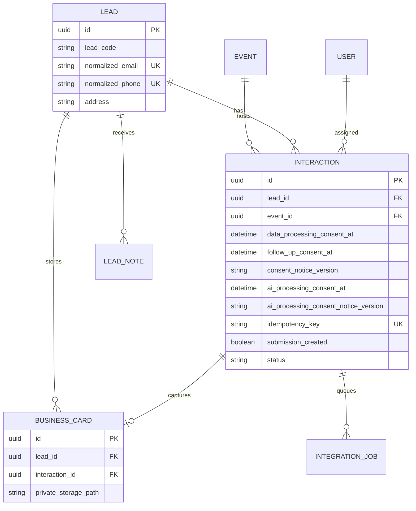

# Database and integration model

The lead is the canonical contact. Each event creates an interaction. Card files remain in private object/local storage; integration jobs synchronize interaction reporting data after commit.
