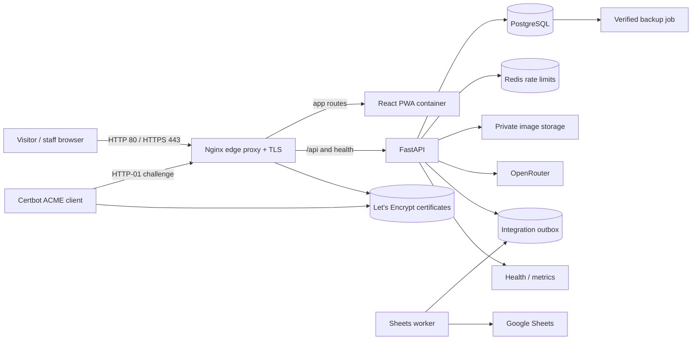

# Deployment flow

Keep provider keys, database credentials, session secrets, and service-account material in the deployment secret store or ignored root `.env`. Only serve the visitor flow over HTTPS so mobile browser camera capture can work.

The Compose `production` profile publishes only Nginx. PostgreSQL and Redis remain private to the Compose network; the frontend's `8080` port binds to loopback for local review. Before certificate issuance, Nginx serves only ACME challenge files over HTTP and returns a temporary 503 for other paths. After issuance it redirects HTTP to HTTPS and loads the TLS virtual host.
